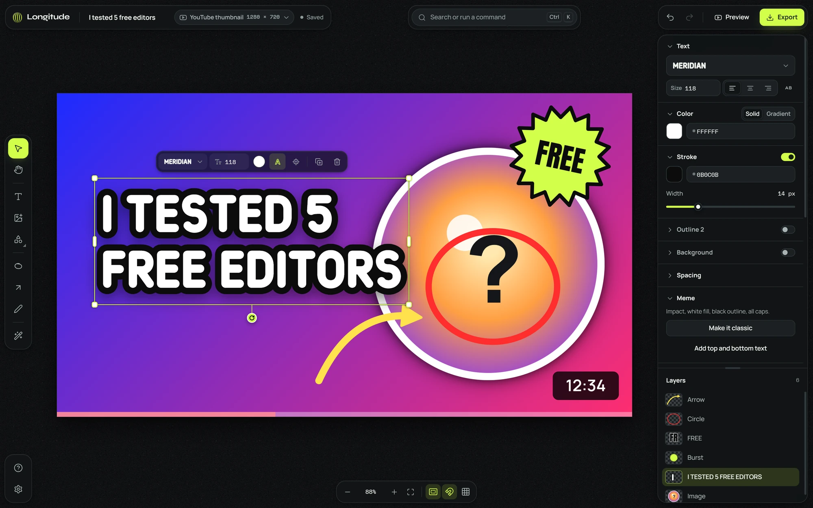
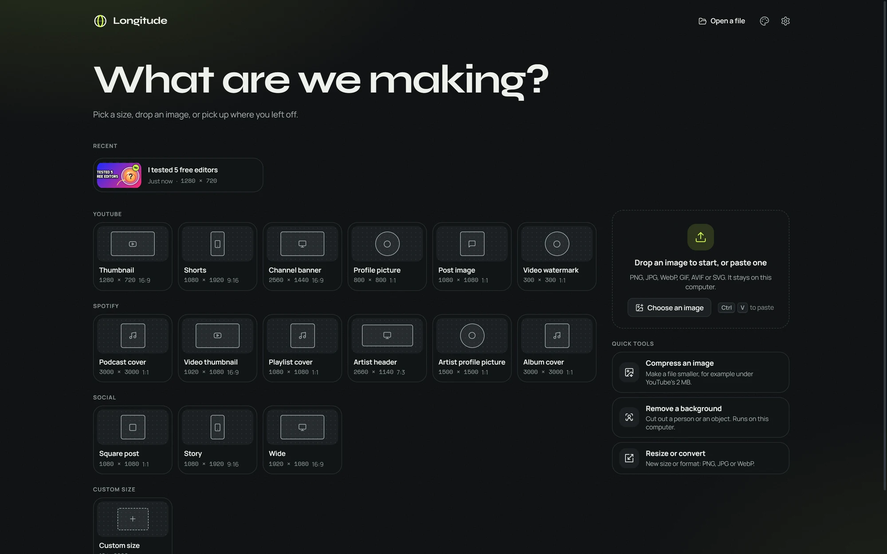

# Longitude

A small, open-source image editor for YouTube thumbnails and Spotify covers.
Bring your own images, stack and resize them with snap guides, add big
stroked text, circle and arrow the thing that matters, cut out the
background, and export under the platform's size limit. No account, no
subscription, no stock library, nothing uploaded.

**Website:** <https://longitude.pictures> ·
**Try it in your browser:** <https://longitude.pictures/app/> (nothing to install)



Longitude is the sibling of [Latitude](https://github.com/zphat/Latitude)
(screen recorder) and [Sundial](https://github.com/zphat/Sundial) (planner)
and shares their look: graphite surfaces, one acid-lime accent, sun-gold for
the moments that need attention.

## Start

**Windows, installed:** get the desktop app (below). Background removal is
included, so nothing else needs to download.

**Windows, from this folder:** double-click `Start Longitude.cmd`. It starts a
local server and opens Longitude in its own Edge window. Keep the black console
window open while you work. The first time, it asks once whether to download
background removal now (about 82 MB) so it works offline; say no and the app
offers it when you need it.

**Any system with Python 3.8+:**

```bash
python serve.py --open
```

Then open <http://localhost:8770>. Chrome and Edge are the main targets;
Firefox works except the color eyedropper. In Edge or Chrome you can install
it as an app (the install icon in the address bar) so it opens like any other
program.

The browser version needs nothing installed and has no build step. The only
thing it ever downloads is the background-removal model, once, when you ask
for it. The desktop app also looks once a day for a newer release (below).

## Desktop app (Windows)

**[Download Longitude-Setup.exe](https://github.com/zphat/Longitude/releases/latest/download/Longitude-Setup.exe)**
(about 36 MB; release notes on the
[latest release](https://github.com/zphat/Longitude/releases/latest) page). It
installs for your Windows account only (no admin rights), and background
removal is included, so it works offline right after install. Best, the
larger model, stays an optional download inside the app.

The installer is not code-signed yet. If Windows SmartScreen warns about it,
choose **More info**, then **Run anyway**.

Once a day the app asks GitHub's API (`api.github.com`) whether a newer
release exists and, if there is one, shows a Download button that opens the
release page. Nothing about you or your designs is sent. Turn it off in
Settings > General > Updates, or with "Automatic update checks on or off" in
the command palette (Ctrl K); "Check for updates" looks right away. Designs in
the desktop app are kept apart from the browser version's; move one across
with Save a copy. Details: [docs/DESKTOP.md](docs/DESKTOP.md).

## What it does

- **Your own media.** Drop images anywhere, paste with Ctrl V, or press `I`.
  PNG, JPEG, WebP, GIF, AVIF, BMP and SVG. Fonts you drop in (TTF, OTF, WOFF,
  WOFF2) are added to the font picker and travel inside your project files.
- **Layers.** Move, resize, rotate, flip, reorder, lock, hide, rename,
  duplicate. Image sides crop, image corners scale. Shift-click or drag a box
  to select several and align or distribute them.
- **Snap guides.** Layers pull to the canvas center, its edges and every other
  layer's edges and center. When something is centered you get a full-length
  lime line and a "Center" label. Hold Ctrl to move freely.
- **Text that reads at thumbnail size.** Live font previews, size, color or
  gradient, stroke and stroke color, a second outline, shadow, glow, a
  background pill, letter spacing and line height. Edit the text right on the
  canvas.
- **Draw.** Highlight circle (`C`), arrows you can bend (`A`), rectangles and
  shapes, and a pressure-aware pen (`P`). Draw a rough circle, line, arrow or
  box with the pen and hold still for half a second: it becomes a clean one.
- **Background removal on your computer.** One click on an image. Then refine
  the edge with an erase/restore brush (`E`), or click away a flat color with
  the magic eraser (`M`). Add a sticker outline to the cutout.
- **Export and compression.** PNG, JPG or WebP at 0.5x to 3x, a quality
  slider, "fit under 2 MB" for YouTube, and a 256-color PNG option that
  shrinks flat graphics a lot. Copy to the clipboard or download.
- **Preview in the feed.** See your design at real size in a mock YouTube home
  grid, search results, up-next column and phone, or a Spotify library, in
  dark and light.
- **Quick tools.** Compress a batch of images, remove one background, or
  resize and convert, without opening a design.
- **Presets.** YouTube thumbnail, Shorts, channel banner (with its safe
  areas), profile picture, post, watermark; Spotify podcast cover, video
  thumbnail, playlist cover, artist header and picture, album cover; square,
  story, wide, custom. Safe-zone overlays show what the platform covers, like
  the duration badge on a thumbnail.
- **Everything is a command.** Ctrl K (or `/`) finds any action, layer or
  preset. Tooltips show the shortcut.
- **Autosave.** Designs save to the browser as you work and appear at the top
  of the home screen. Save a portable `.longitude` file (images and custom
  fonts included) to back up or move a design.
- **Light on your machine.** Plain files, no frameworks. The editor loads
  about 1.1 MB of code at start; export, quick tools, the feed preview,
  settings and background removal load the first time you use them. Works
  offline once it has opened.



## Shortcuts

| Keys | Action |
| --- | --- |
| `V` `H` `T` `R` `O` `C` `A` `P` | Select, hand, text, rectangle, ellipse, highlight circle, arrow, pen |
| Space (hold) | Pan |
| `I` | Add an image |
| `E` / `M` | Refine a cutout / magic eraser |
| Ctrl K or `/` | Command palette |
| Ctrl Z / Ctrl Shift Z | Undo / redo |
| Ctrl D, Delete | Duplicate, delete |
| Shift C | Center the selection on the canvas |
| Arrow keys (Shift for 10 px) | Nudge |
| Ctrl ] / Ctrl [ | Bring forward / send backward |
| Ctrl 0 | Fit the canvas to the window |
| Shift B | Remove background |
| F | Preview in the feed |
| Ctrl E | Export |
| Shift ? | All shortcuts |

## Fonts

Twenty-eight bundled families, all free to use in your thumbnails, plus
Impact and Arial Black when your system has them:

- **Made for Longitude:** Meridian, Meridian Slant (heavy rounded capitals for
  thumbnails), Gridline and Gridline Dot (pixel and LED). Built by
  `tools/fonts/build_original.py`.
- **Thumbnail classics:** Anton, Bebas Neue, Montserrat, Oswald, Archivo
  Black, Poppins, Luckiest Guy, Lilita One, Rubik.
- **Meme:** Bangers, Comic Neue, Permanent Marker, and Impact and Arial
  Black from your system.
- **Display:** Bungee, Monoton, Black Ops One, Press Start 2P, Creepster,
  Unbounded, Righteous, Russo One, Syne, Rubik Glitch.
- **Clean:** Inter, Manrope.

Licenses and credits are in [docs/FONTS.md](docs/FONTS.md) and
`web/fonts/LICENSES/`.

## Background removal

Runs entirely on your computer with
[ONNX Runtime Web](https://onnxruntime.ai/), on the GPU when WebGPU is
available. Your image never leaves your computer.

| Mode | Model | Download | License |
| --- | --- | --- | --- |
| Fast (default) | IS-Net general use, int8 | about 69 MB once (58 MB without WebGPU); included in the desktop app | Apache-2.0 |
| Best | BiRefNet lite | about 148 MB once (up to 224 MB without a capable GPU) | MIT |
| Magic | Flat-color flood fill | none | MIT |

The sizes include the shared runtime, which comes once with the first model.
Until Fast is here, Home shows a "Get background removal ready" card with its
size and a Download now button, and the Remove background button carries a
line like "One-time 69 MB download". While a model downloads, a sun-gold pill
in the top bar shows the progress (click it for details or Cancel), and you
can keep working. Settings > Background removal lists each model with its
state and size, with Download, Cancel and Delete.

Downloads are cached by the browser, so later sessions start straight away.
To work fully offline, run `python tools/fetch_model.py` once (Start
Longitude.cmd offers this on its first run); it stores the runtime and models
in `web/vendor/`. Details and sources: [docs/BGREMOVE.md](docs/BGREMOVE.md).

## Mods

Longitude is built to be changed.

- **Packs** are JSON files with themes, presets and color palettes. They
  never run code. Latitude theme packs import as they are.
- **Code mods** are folders in `web/mods/`, listed in `web/mods/mods.json`.
  A mod gets a small, versioned API to add commands, tools, inspector
  sections, shapes, image filters, presets, fonts, themes and
  background-removal providers. Everything it registers is removed when you
  turn it off in Settings.

Four example mods ship with the app: classic meme text, sticker shapes, a
deep-fry filter and starter layouts. Start with
[docs/MODDING.md](docs/MODDING.md).

Mods are trusted local code, not a sandbox: only add mods whose source you
have read.

## Project layout

```
serve.py, Start Longitude.cmd   local server and Windows launcher
src-tauri/, package.json        the Windows desktop app (built by GitHub Actions only)
web/                            the app (static files)
  index.html, main.js           shell and boot
  js/core/                      document model, history, rendering, assets, fonts
  js/editor/                    canvas, selection, snapping, tools, text editing
  js/ui/                        panels, pickers, dialogs, export, feed preview
  js/features/                  background removal, compression, presets
  js/mods/  mods/               mod loader and the example mods
  fonts/  presets/  icons/
tools/                          font build, model fetch, module checker
tests/                          Deno unit tests
docs/                           SPEC (architecture contract), modding, fonts, background removal, desktop app
brand/                          the logo (SVG and PNG) and when to use which file
site/                           the website; GitHub Pages publishes it with web/ as app/ (.github/workflows/pages.yml)
```

## Development

There is no build. Edit a file and reload (add `?nosw` to the URL to bypass
the offline cache while developing). With [Deno](https://deno.com/):

```bash
deno run --allow-read tools/check.mjs
```

```bash
deno test --allow-read tests/
```

The first checks that every module links (syntax, paths, named exports);
the second runs the unit tests. `docs/SPEC.md` describes the document model,
the module boundaries and the design language.

## Privacy

No accounts, no analytics, no network calls except the optional one-time
model download and, in the desktop app, a once-a-day look at GitHub's latest
release (turn it off in Settings > General > Updates). Designs live in your
browser's storage, or the desktop app's, until you delete them or export them.

## License

MIT. Fonts are under the SIL Open Font License or Apache 2.0 (see
`web/fonts/LICENSES/`). Third-party notices: [docs/THIRD-PARTY-NOTICES.md](docs/THIRD-PARTY-NOTICES.md).
